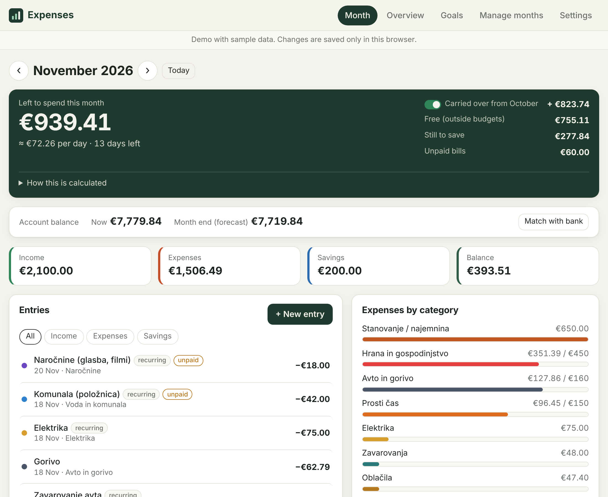

# Expenses – personal monthly budget

**[Slovenščina](README.sl.md)** · English

Track income, bills and savings goals month by month and always know **how much you can still spend this month**.
Self-hosted, no cloud account needed, no dependencies, works on a phone. Interface in Slovenian, English and German (the language you pick is remembered on every device).



## Features

- **Month**: income, expenses and savings; *left to spend* and *per day* for the rest of the month
- **Recurring entries** (salary, rent, subscriptions) filled in automatically; marked paid on the due day, or wait for your confirmation for bills you pay yourself
- **Category budgets** with warnings, **savings goals** with a start month and deadline – the monthly amount is reserved for you
- **Carry-over** of what is left to the next month (can be turned off per month), or move it to a goal
- **Account balance** computed from your entries after you enter your real bank balance once
- **Overview** charts by month, category and year
- **Excel import** (one sheet per month), CSV and JSON export
- **Backups**: automatic (daily/weekly/monthly) and manual, with restore
- **Home Assistant** sensors via a REST endpoint
- Optional **update check** (Settings → Updates)

## Which edition?

| Edition | Data is kept | Good for |
|---|---|---|
| **Docker** (recommended) | SQLite file on your server/NAS | Synology, Unraid, Raspberry Pi, any Docker host; Home Assistant |
| **Local** – `Expenses.html` | a folder on your computer (can be OneDrive/Dropbox) | one computer with Chrome or Edge, nothing to install |
| **Google** – Apps Script | your Google Drive | phone + computer + sharing with a partner, no server |
| **Demo** | your browser only | trying it out |

Data can be moved between editions: export `.json` (Docker: Settings → Data) and import it in the local or Google edition.

Download everything from the **[latest release](https://github.com/CasperDIY/expenses/releases/latest)**.

---

## Install: Docker

You only need the `docker-compose.yml` file from the [latest release](https://github.com/CasperDIY/expenses/releases/latest). The image is prebuilt for amd64, arm64 and armv7 – nothing is compiled on your machine.

### Synology (Container Manager)

1. In **File Station**, create the folder `docker/expenses` and inside it a folder `data`.
2. **Container Manager → Project → Create**. Name: `expenses`, path: `docker/expenses`, source: *Create docker-compose.yml*, and paste the contents of `docker-compose.yml`.
3. Set `APP_USER` and `APP_PASSWORD` (your login), and `API_TOKEN` if you use Home Assistant. Leave the rest.
4. **Next → Done.** Open `http://NAS-IP:8080`.

### Any other Docker host

```bash
mkdir expenses && cd expenses
curl -LO https://github.com/CasperDIY/expenses/releases/latest/download/docker-compose.yml
# edit APP_USER / APP_PASSWORD in docker-compose.yml
docker compose up -d
```

All settings are in `docker-compose.yml`:

| Variable | Meaning |
|---|---|
| `APP_USER`, `APP_PASSWORD` | login for the web page (both empty = no login, trusted network only) |
| `API_TOKEN` | token for Home Assistant; empty = endpoint off |
| `TZ` | time zone, e.g. `Europe/Berlin` |
| `PUID`, `PGID` | owner of the files in `data` (default 1000) |
| `BACKUP_DIR` | another folder for backups (add a matching volume) |

Do not expose port 8080 directly to the internet: use a VPN (WireGuard, Tailscale) or a reverse proxy with HTTPS.

## Install: Local (one file)

1. Download `Expenses.html` from the [latest release](https://github.com/CasperDIY/expenses/releases/latest) and open it in **Chrome** or **Edge**.
2. Choose a folder for your data (e.g. `Documents/Expenses`). Next time you only confirm it.

## Install: Google (Drive)

1. Open [script.google.com](https://script.google.com) → **New project**.
2. **Project settings** (gear) → tick *Show "appsscript.json" manifest file in editor*.
3. Replace the contents of three files with the ones from the [latest release](https://github.com/CasperDIY/expenses/releases/latest):
   - `Code.gs` → the code file (`Code.gs`)
   - `appsscript.json` → `appsscript.json`
   - `index.html` → **+ → HTML**, name it exactly `index`
4. **Deploy → New deployment → Web app → Deploy**, allow access, open the web app link (add it to your phone's home screen).

Data is stored in the folder **Expenses** in your Drive, with a Google Sheet *Expenses – overview* for viewing.

**Sharing with a partner:** share the **Expenses** folder in Drive with them as *Editor* and send them the web app link. Both of you see the same data; if you both edit at the same time, the app does not overwrite anything and offers to load the newest data.

---

## Updates

Updates are **optional**. In the app, *Settings → Updates* can check GitHub for a new version when the app opens (off by default; only the version number is read, nothing is sent). How to update:

- **Docker / Synology** – *Container Manager → Image →* select the image → **Update** (the container restarts with the new version), or `docker compose pull && docker compose up -d`. Your `data` folder is not touched.
  Fully automatic: uncomment the Watchtower lines in `docker-compose.yml`.
- **Local** – download the new `Expenses.html` and replace the old one. Data stays in your folder.
- **Google** – by hand: paste the new `Code.gs` and `index.html`, then *Deploy → Manage deployments → ✎ → Version: New version → Deploy*.
  **One-click** (optional, owner only), set up once:
  1. Turn on *Google Apps Script API* at [script.google.com/home/usersettings](https://script.google.com/home/usersettings).
  2. Replace `appsscript.json` with `appsscript-autoupdate.json` from the release (it adds the permission to update the project).
  3. Deploy a new version once and allow the new permissions.

  From then on, *Settings → Updates → Update now* replaces the code and points your web app to the new version.
  Note: everyone who opens the app is asked for the same permissions – skip this if you share the app and prefer fewer permissions.

## Home Assistant

`GET http://SERVER:8080/api/ha/summary` with header `Authorization: Bearer <API_TOKEN>` returns the current month as JSON
(`left_to_spend`, `per_day`, `free_to_spend`, `income`, `expenses`, `savings`, `account_balance`, `unpaid_bills`, `overdue_count`, `days_left`, `goals` …).

```yaml
# configuration.yaml
rest:
  - resource: http://SERVER:8080/api/ha/summary
    headers:
      Authorization: !secret expenses_token   # secrets.yaml: expenses_token: "Bearer <API_TOKEN>"
    scan_interval: 900
    sensor:
      - name: "Budget left"
        unique_id: expenses_left_to_spend
        value_template: "{{ value_json.left_to_spend }}"
        unit_of_measurement: "€"
        device_class: monetary
      - name: "Budget per day"
        unique_id: expenses_per_day
        value_template: "{{ value_json.per_day or 0 }}"
        unit_of_measurement: "€"
        device_class: monetary
      - name: "Bills due"
        unique_id: expenses_overdue
        value_template: "{{ value_json.overdue_count }}"
```

To show the app in the sidebar: *Settings → Dashboards → Add dashboard → Webpage* with `http://SERVER:8080`.

## How "left to spend" is calculated

```
left to spend = carried over + income − expenses − already saved − still to save for goals this month
month end     = carried over + income − expenses − savings          (carried over to the next month)
free          = left to spend − unused part of category budgets
per day       = left to spend / days left in the month
```

---

## Development

Only Python 3.10+ is needed.

```bash
DB_PATH=./data/expenses.db python3 app/server.py   # run the server at http://localhost:8080
python3 -m unittest discover -s tests             # tests
sh build/all.sh                                   # build the local, Google and demo editions into dist/
```

- `app/` – server (`server.py`, stdlib + SQLite) and the web page (`static/`)
- `src/` – i18n core and the in-browser backend shared by the local, Google and demo editions
- `gas/` – Google Apps Script server code and manifests
- `build/` – builds the single-file editions; UI texts are Slovenian in the code, translations are in `build/translations.py`
- `tools/db2json.py` – convert a Docker database to the `.json` used by the local and Google editions

### Publishing a release (maintainers)

1. Update `VERSION` (e.g. `1.1.0`) and add a section to `CHANGELOG.md`.
2. Commit, then `git tag v1.1.0 && git push --tags`.
3. The *Release* workflow tests, builds the Docker image (`ghcr.io/<owner>/<repo>`) and creates the GitHub release with all files.

First time after forking: run `python3 tools/set-repo.py yourname/expenses` so links in the README point to your repository,
and after the first release make the container package public (*your profile → Packages → expenses → Package settings → Change visibility → Public*),
otherwise others cannot pull the image. The demo can be published on GitHub Pages: *Settings → Pages → Source: GitHub Actions*.

## Support

Expenses is free and open source. If it saves you time or money, you can buy me a coffee:

[](https://www.paypal.me/tadejgolob)

<a href="https://www.paypal.com/qrcodes/p2pqrc/77HJH6H5FBV5N"></a>

## License

[MIT](LICENSE)
