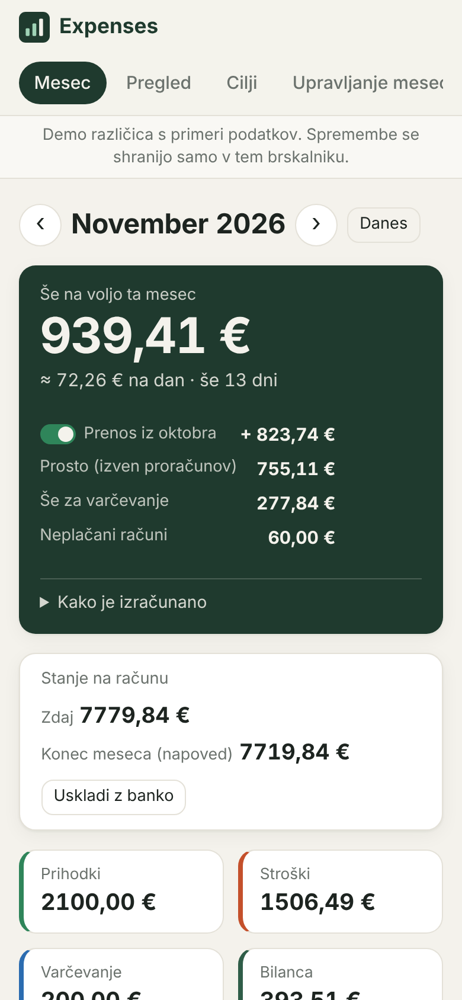

# Expenses – osebni mesečni proračun

Slovenščina · **[English](README.md)**

Vodenje prihodkov, računov in ciljev varčevanja po mesecih – vedno veš, **koliko lahko ta mesec še porabiš**.
Teče na tvojem strežniku, brez oblačnih računov in zunanjih odvisnosti, deluje tudi na telefonu. Vmesnik v slovenščini, angleščini in nemščini (izbrani jezik si zapomni na vseh napravah).



## Kaj zna

- **Mesec**: prihodki, stroški in vplačila na cilje; *še na voljo* in *na dan* do konca meseca
- **Ponavljajoči vnosi** (plača, najemnina, naročnine) se vpišejo sami; na dan zapadlosti se označijo kot plačani ali čakajo na tvojo potrditev
- **Proračuni po kategorijah** z opozorili, **cilji varčevanja** z začetkom in rokom – mesečni znesek se rezervira sam
- **Prenos ostanka** v naslednji mesec (izklopljiv za vsak mesec) ali na cilj
- **Stanje na računu**, izračunano iz vnosov, ko enkrat vpišeš dejansko stanje iz banke
- **Pregled** z grafi po mesecih, kategorijah in letih
- **Uvoz iz Excela**, izvoz CSV in JSON
- **Varnostne kopije**: samodejne in ročne, z obnovitvijo
- **Home Assistant** senzorji
- Neobvezno **preverjanje posodobitev** (Nastavitve → Posodobitve)

## Katero različico?

| Različica | Kje so podatki | Primerna za |
|---|---|---|
| **Docker** (priporočeno) | SQLite datoteka na strežniku/NAS-u | Synology, Raspberry Pi, kateri koli Docker; Home Assistant |
| **Lokalna** – `Expenses.html` | mapa na računalniku (lahko OneDrive) | en računalnik s Chromom ali Edgom, brez namestitve |
| **Google** – Apps Script | tvoj Google Drive | telefon + računalnik + skupna raba s partnerjem, brez strežnika |
| **Demo** | samo brskalnik | preizkus |

Podatke preneseš med različicami z izvozom `.json` (Docker: Nastavitve → Podatki) in uvozom v lokalni ali Google različici.

Vse datoteke so v **[zadnji izdaji](https://github.com/CasperDIY/expenses/releases/latest)**.

---

## Namestitev: Docker

Potrebuješ samo datoteko `docker-compose.yml` iz [zadnje izdaje](https://github.com/CasperDIY/expenses/releases/latest). Slika je že zgrajena (amd64, arm64, armv7).

### Synology (Container Manager)

1. V **File Station** ustvari mapo `docker/expenses` in v njej mapo `data`.
2. **Container Manager → Projekt → Ustvari**. Ime: `expenses`, pot: `docker/expenses`, vir: *Ustvari docker-compose.yml*, prilepi vsebino `docker-compose.yml`.
3. Nastavi `APP_USER` in `APP_PASSWORD` (prijava) ter `API_TOKEN`, če uporabljaš Home Assistant.
4. **Naprej → Končano.** Odpri `http://IP-NAS:8080`.

### Drug Docker strežnik

```bash
mkdir expenses && cd expenses
curl -LO https://github.com/CasperDIY/expenses/releases/latest/download/docker-compose.yml
# v docker-compose.yml nastavi APP_USER / APP_PASSWORD
docker compose up -d
```

Vrat 8080 ne izpostavljaj neposredno na internet – uporabi VPN (WireGuard, Tailscale) ali reverse proxy s HTTPS.

## Namestitev: Lokalna (ena datoteka)

1. Prenesi `Expenses.html` iz [zadnje izdaje](https://github.com/CasperDIY/expenses/releases/latest) in jo odpri v **Chromu** ali **Edgu**.
2. Izberi mapo za podatke (npr. `Dokumenti/Expenses`). Naslednjič jo samo potrdiš.

## Namestitev: Google (Drive)

1. Odpri [script.google.com](https://script.google.com) → **Nov projekt**.
2. **Nastavitve projekta** (zobnik) → obkljukaj *Pokaži datoteko manifesta »appsscript.json« v urejevalniku*.
3. Vsebino treh datotek zamenjaj z datotekami iz [zadnje izdaje](https://github.com/CasperDIY/expenses/releases/latest):
   - `Code.gs` → datoteka s kodo (`Koda.gs`)
   - `appsscript.json` → `appsscript.json`
   - `index.html` → **+ → HTML**, ime natanko `index`
4. **Uvedi → Nova uvedba → Spletna aplikacija → Uvedi**, dovoli dostop in odpri povezavo (na telefonu jo dodaj na začetni zaslon).

Podatki so v mapi **Expenses** v tvojem Drivu, s preglednico *Expenses – overview* za ogled.

**Skupna raba s partnerjem:** mapo **Expenses** v Drivu deli z njim kot *Urejevalec* in mu pošlji povezavo do aplikacije.

---

## Posodobitve

Posodobitve so **neobvezne**. V aplikaciji lahko v *Nastavitve → Posodobitve* vklopiš preverjanje nove različice ob odprtju (privzeto izklopljeno; prebere se samo številka različice, ničesar se ne pošilja).

- **Docker / Synology** – *Container Manager → Slika →* izberi sliko → **Posodobi**, ali `docker compose pull && docker compose up -d`. Mapa `data` ostane nedotaknjena.
  Popolnoma samodejno: odkomentiraj vrstice za Watchtower v `docker-compose.yml`.
- **Lokalna** – prenesi novo `Expenses.html` in z njo zamenjaj staro.
- **Google** – ročno: prilepi nova `Code.gs` in `index.html`, nato *Uvedi → Upravljaj uvedbe → ✎ → Različica: Nova različica → Uvedi*.
  **Z enim klikom** (neobvezno, samo lastnik), enkratna nastavitev:
  1. Vklopi *Google Apps Script API* na [script.google.com/home/usersettings](https://script.google.com/home/usersettings).
  2. `appsscript.json` zamenjaj z `appsscript-autoupdate.json` iz izdaje.
  3. Enkrat uvedi novo različico in dovoli nova dovoljenja.

  Nato *Nastavitve → Posodobitve → Posodobi zdaj* sama zamenja kodo in uvedbo.
  Opomba: ista dovoljenja potrdi vsak, ki odpre aplikacijo – če jo deliš, raje posodabljaj ročno.

## Home Assistant

`GET http://STREZNIK:8080/api/ha/summary` z glavo `Authorization: Bearer <API_TOKEN>`. Primer konfiguracije je v [angleških navodilih](README.md#home-assistant).

## Razvoj

```bash
DB_PATH=./data/expenses.db python3 app/server.py   # strežnik na http://localhost:8080
python3 -m unittest discover -s tests             # testi
sh build/all.sh                                   # lokalna, Google in demo različica v dist/
```

Nova izdaja: spremeni `VERSION`, dopolni `CHANGELOG.md`, nato `git tag v1.1.0 && git push --tags`. Več v [angleških navodilih](README.md#publishing-a-release-maintainers).

## Podpora

Expenses je brezplačen in odprtokoden. Če ti prihrani čas ali denar, mi lahko častiš kavo:

[](https://www.paypal.me/tadejgolob)

<a href="https://www.paypal.com/qrcodes/p2pqrc/77HJH6H5FBV5N"></a>

## Licenca

[MIT](LICENSE)
